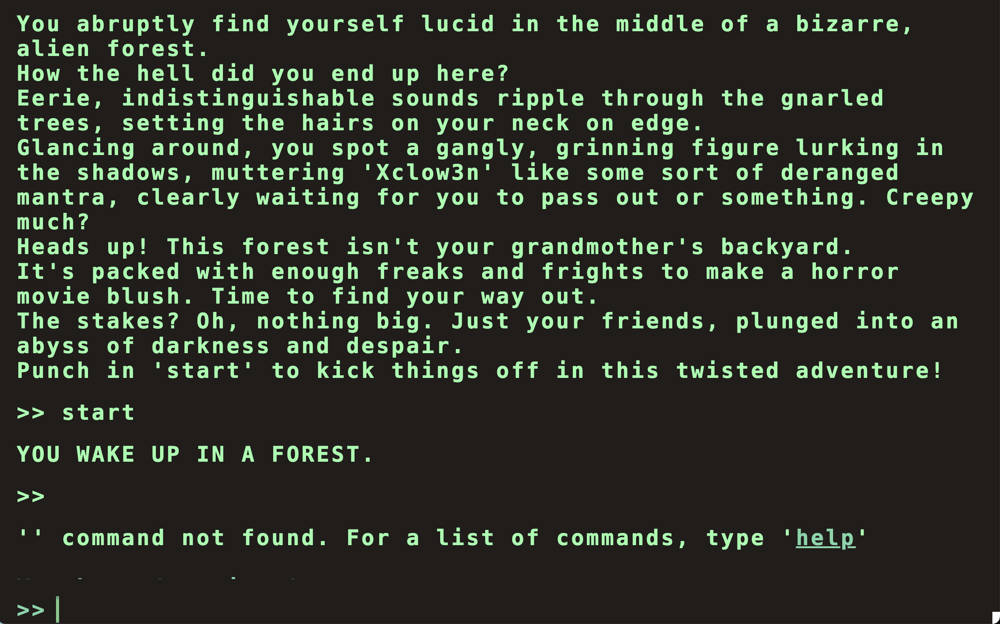
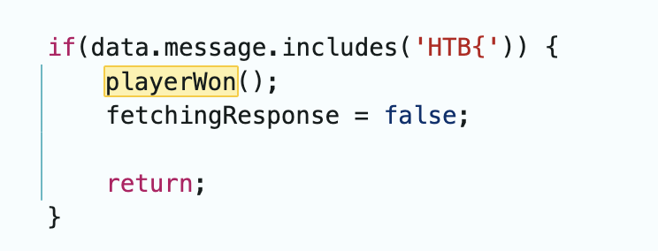
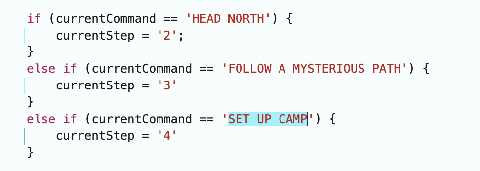
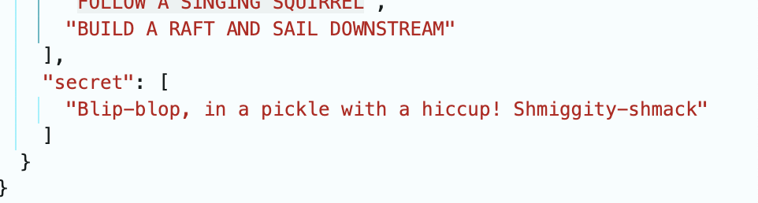

# Flag Command

> **Category:** Web **|** **Difficulty:** Very Easy

### Summary

The target is an interactive browser-based text adventure game. Inspecting the client-side JavaScript and intercepted API responses reveals a hidden command that instantly triggers the win condition.



### Analysis & Exploitation

**Client-side Inspection:** Checking `main.js` reveals that the game determines victory by checking if the server response contains the flag format:

```javascript
if (data.message.includes('HTB{')) { playerWon(); ... }
```



**Information Leakage:** While the source outlines standard choice paths (`HEAD NORTH`, `FOLLOW A MYSTERIOUS PATH`, `SET UP CAMP`), examining the `/api/options` response exposes an unlisted secret command:





```json
"secret": [
  "Blip-blop, in a pickle with a hiccup! Shmiggity-shmack"
]
```

**Exploit:** Entering this string directly into the terminal bypasses the game progression entirely. The server validates the command and returns the flag: `HTB{...}`.
